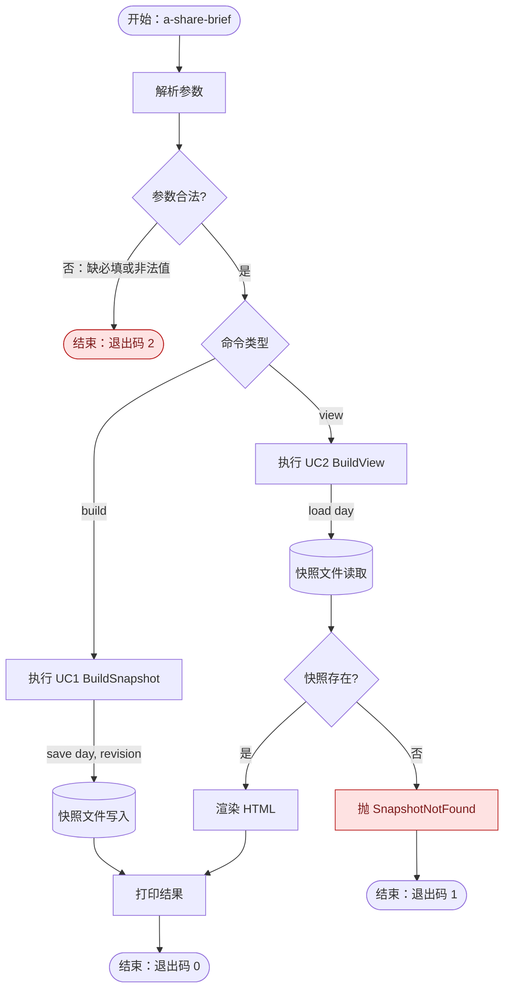
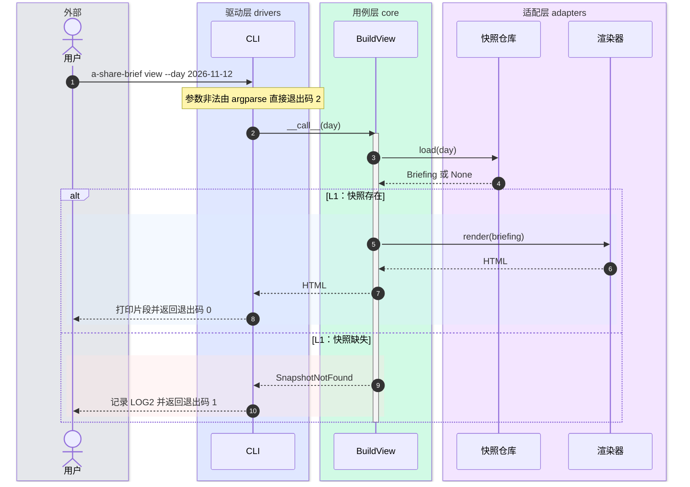
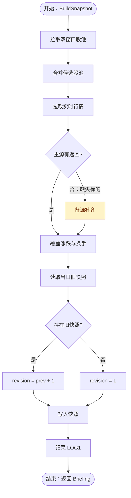
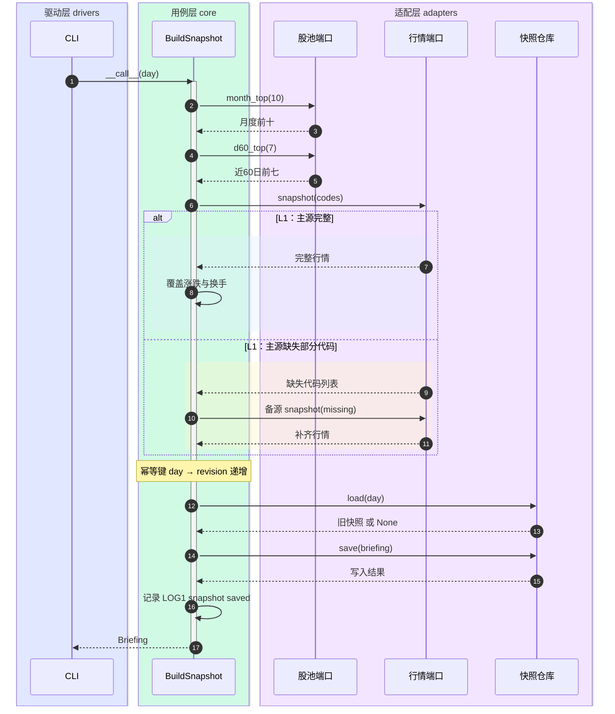
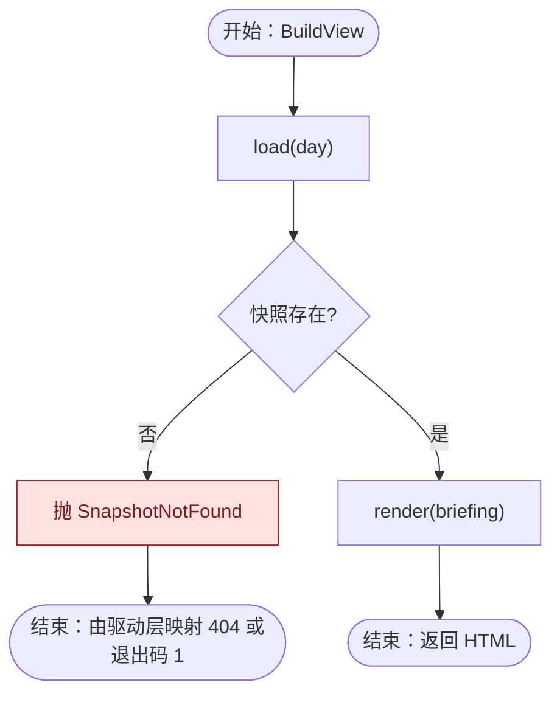
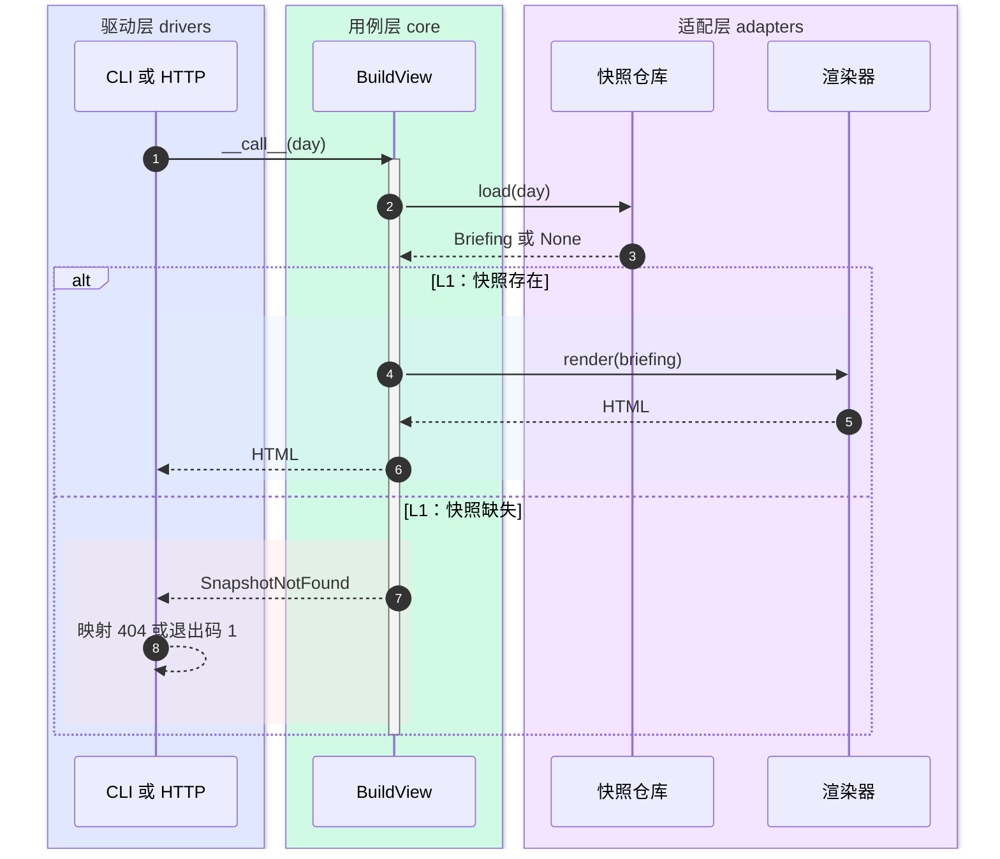

# 详细设计：A 股每日看板（P1 内核）

编码约束见 [13_后端编码规约](13_后端编码规约.md)。

范围：`build` 写路径与 `view` 读路径的落地实现。链路依据见 [CODE_LINK_TREE.md](11_代码链路树.md)。

## 一、实现清单

| 编号 | 对象 | 说明 | 状态 |
| --- | --- | --- | --- |
| CLI1-a-share-brief | 命令入口 | `build` / `view` | 已实现 |
| UC1-BuildSnapshot | 用例（写） | 采集股池+行情，固化快照 | 已实现（P1 占位数据源） |
| UC2-BuildView | 用例（读） | 快照 → HTML | 已实现 |
| DB1-briefing_day | 快照表 | `day + revision` 唯一 | P1 用文件，P2 建表 |
| PORT1-QuotePort | 端口 | 行情快照 | 已实现 |
| PORT2-PoolPort | 端口 | 双窗口股池 | 已实现 |
| PORT3-SnapshotRepo | 端口 | 快照读写 | 已实现 |
| PORT4-BoardRenderer | 端口 | HTML 渲染 | 已实现 |
| JOB1-refresh_live | 定时任务 | 60s 实时行情 | 拟定（P2） |
| JOB2-build_snapshot | 定时任务 | 15:08 固化快照 | 拟定（P2） |
| LOG1-snapshot-saved | 日志 | 快照写入结果 | 已实现 |
| LOG2-view-failed | 日志 | 读视图失败 | 已实现 |

## 一之二、组合根

- `interfaces/composition.py` 是唯一装配依赖的地方：`quotes_port()` 主备组合、`build_snapshot_usecase()` 注入股池/行情/异动/指数端口。
- CLI 的 `build` 默认走真实适配器，`--demo` 使用空端口离线演示。

## 二、CLI1-a-share-brief（命令行入口）

- 设计模式：新增。
- 链路摘要：`cli.main` 解析参数 → 装配 `FileRepoAdapter` → 分派 `UC1` 或 `UC2` → 打印结果/退出码。




交互序列：

1. 解析 `cmd` / `--day` / `--root` / `-v`。
2. 初始化日志（`ts level module msg` 格式）。
3. 装配 `FileRepoAdapter(root)`。
4. `build` 调 `UC1`；`view` 调 `UC2`。
5. `view` 捕获 `SnapshotNotFound`，记 `LOG2` 并返回 1。
6. 成功打印并返回 0。

入参示例：

```json
{"cmd": "view", "day": "2026-11-12", "root": "work/store", "verbose": false}
```

出参示例（`build`）：

```json
{"exit_code": 0, "stdout": "snapshot saved: 2026-11-12"}
```

出参示例（`view` 失败）：

```json
{"exit_code": 1, "stderr": "level=ERROR msg=view failed day=2026-01-01 reason=no snapshot for 2026-01-01"}
```

状态码：

| 码 | 触发 | 出口 |
| --- | --- | --- |
| 0 | 命令执行成功 | 打印结果 |
| 1 | `SnapshotNotFound` | 记 `LOG2`，返回 1 |
| 2 | 参数非法 | argparse 退出 |

涉及文件：

- drivers::cli::cli.py — 入口（已存在）
- core::usecases::build_snapshot.py — 用例（已存在）
- core::usecases::build_view.py — 用例（已存在）

## 二之二、HTTP 接口

| 接口 | 方法 | 行为 |
| --- | --- | --- |
| `/healthz` | GET | 快照天数与最新日期 |
| `/api/history` | GET | 可用日期列表 |
| `/api/briefing?date=` | GET | 完整快照（指数/股池/个股） |
| `/api/pool/{window}?date=` | GET | 单窗口排名，未知窗口 400、无数据 404 |
| `/api/pool/history?window=&days=` | GET | 跨日矩阵（默认近 6 个交易日），行=名次、列=交易日 |
| `/api/alert?codes=` | GET | 指定代码的异动 |
| `/api/themes?date=` | GET | 当日题材：锚点、成员、炒作逻辑（实时快照由 F10 行业生成） |
| `/api/live` | GET(SSE) | 指数摘要流，参数 `ticks`、`interval` |

启动：`make api`（`api.py` 装配、`api_routes.py` 业务路由、`api_live.py` SSE；快照目录读 `BRIEF_STORE`，默认 `work/store`），接口测试 `make api-test`。

## 三、UC1-BuildSnapshot（写路径）

- 设计模式：新增。
- 链路摘要：`main` → `BuildSnapshot.__call__` → `PoolPort`×2 → `QuotePort` → `SnapshotRepo.load/save`。







交互序列：

1. 拉取月度前十与近 60 日前七。
2. 合并为候选股池。
3. 拉取实时行情，按代码覆盖涨跌与换手。
4. 读取同一交易日旧快照，计算 `revision`。
5. 写入新版本并记 `LOG1`。

入参示例：

```json
{"day": "2026-11-12"}
```

出参示例：

```json
{"day": "2026-11-12", "revision": 2, "stocks": 17}
```

状态码：命令层无独立 HTTP 码；失败由驱动层映射（P2 定时任务记 `job_run`）。

涉及文件：

- core::usecases::build_snapshot.py — 用例（已存在）
- adapters::fallback::fallback.py — 容灾组合（已存在）
- adapters::file_repo::file_repo.py — 存储（已存在）

## 三之二、调度器与任务

- `interfaces/scheduler.py`：任务注册表 + 执行器，记录 `job_run`（JSONL，P2 迁 PG）。
- `interfaces/jobs.py`：把用例包装为任务；当前注册 `build_snapshot`（cron `08 15 * * 1-5`）。
- 失败重试：默认 2 次，逐次记录 `attempt`；耗尽后 `status=failed` 并写错误摘要。
- 运行示例：`sched.run("build_snapshot", date.today())`。

## 四、UC2-BuildView（读路径）

- 设计模式：新增。
- 链路摘要：`main` → `BuildView.__call__` → `SnapshotRepo.load` → `BoardRenderer.render`。





交互序列：

1. 按日加载快照。
2. 缺失即抛 `SnapshotNotFound`。
3. 交给渲染端口生成 HTML。
4. 返回字符串给驱动层。

入参示例：

```json
{"day": "2026-11-12"}
```

出参示例：

```json
{"html": "<!doctype html><h1>2026-11-12 · rev 2</h1>"}
```

状态码（P2 HTTP）：

| 码 | 触发 |
| --- | --- |
| 200 | 快照存在 |
| 404 | `SnapshotNotFound` |

涉及文件：

- core::usecases::build_view.py — 用例（已存在）
- adapters::html_renderer::html_renderer.py — 渲染（已存在）

## 五、JOB1-refresh_live（拟定）

- 设计模式：新增（P2）。
- 链路摘要：调度触发 → `RefreshLive` → `FallbackQuotes` → 写 live 表 → 推送。

调度配置（以 xxl-job 为例）：

| 项 | 值 |
| --- | --- |
| 执行器 | `a-share-brief-executor`（拟定） |
| JobHandler | `refreshLiveHandler`（拟定） |
| Cron | `0 * 9-11,13-15 ? * MON-FRI` |
| 路由策略 | 第一个 |
| 阻塞处理 | 单机串行 |
| 任务超时 | 30s |
| 失败重试 | 2 次 |
| 任务参数 | 默认全部股票；可选 `codes=002578,002086` |

## 六、JOB2-build_snapshot（拟定）

| 项 | 值 |
| --- | --- |
| 执行器 | `a-share-brief-executor` |
| JobHandler | `buildSnapshotHandler` |
| Cron | `0 8 15 ? * MON-FRI` |
| 路由策略 | 第一个 |
| 阻塞处理 | 单机串行 |
| 任务超时 | 300s |
| 失败重试 | 3 次 |
| 任务参数 | 默认当天；可选 `day=2026-11-12` |

## 七、数据表关系

- `DB1-briefing_day`：`day + revision` 主键，存整体快照 `payload`；所有读取按 `day` 取最新 `revision`。
- `DB2-job_run`（拟定）：每次任务执行一行，`(job, day)` 索引用于补跑与审计。

建表与索引（拟定，P2 执行）：

```sql
CREATE TABLE briefing_day (
    day        date        NOT NULL,
    revision   int         NOT NULL,
    payload    jsonb       NOT NULL,
    created_at timestamptz NOT NULL DEFAULT now(),
    PRIMARY KEY (day, revision)
);

CREATE TABLE job_run (
    id         bigserial   PRIMARY KEY,
    job        text        NOT NULL,
    day        date        NOT NULL,
    started_at timestamptz NOT NULL DEFAULT now(),
    finished_at timestamptz,
    status     text        NOT NULL,
    detail     jsonb
);
CREATE INDEX idx_job_run_job_day ON job_run (job, day);
```

索引依据：

- `briefing_day` 查询为 `WHERE day = $1 ORDER BY revision DESC LIMIT 1`，主键最左前缀 `day` 已覆盖。
- `job_run` 查询为 `WHERE job = $1 AND day = $2`，等值条件，`(job, day)` 复合索引最左前缀匹配；无需额外索引。

## 八、关键约束

- 依赖方向：`core` 不得 import `adapters`/`drivers`，由 `tests/test_architecture.py` 与 import-linter 拦截。
- 幂等：同日重跑只增 `revision`，不改历史行。
- 容灾：主源失败由 `FallbackQuotes` 补齐，不改变用例。
- 日志：仅记业务结果与失败原因，字段 `day/revision/codes/reason`，不含密钥。
- 性能：P1 单文件读写；P2 单日快照 ≤ 100 行股池，读放大可忽略；页面渲染走缓存。

## 九、待确认项

- P2 的 HTTP 层是否直接复用 `FileRepoAdapter`（迁移期双读）还是切 PG 单读。
- `refresh_live` 与 `build_snapshot` 是否同执行器（当前按同执行器拟定）。

## 十、图校验记录

- 渲染器：`mmdc 10.9.1`（`npx @mermaid-js/mermaid-cli@10`，Chrome headless）。
- 流程图：`python3 ~/.agents/skills/mermaid-flowchart/scripts/validate_examples.py docs/10_详细设计.md --require-render` → **静态校验和实际渲染通过：3 个图**。
- 时序图：`python3 ~/.agents/skills/mermaid-sequence-diagram/scripts/validate_examples.py docs/10_详细设计.md --require-render` → **静态校验和实际渲染通过：3 个图**。
- 修复记录：`load(day)`、`render(briefing)` 直接写在节点 `[]` 内会导致 Mermaid 解析失败，已加引号。
