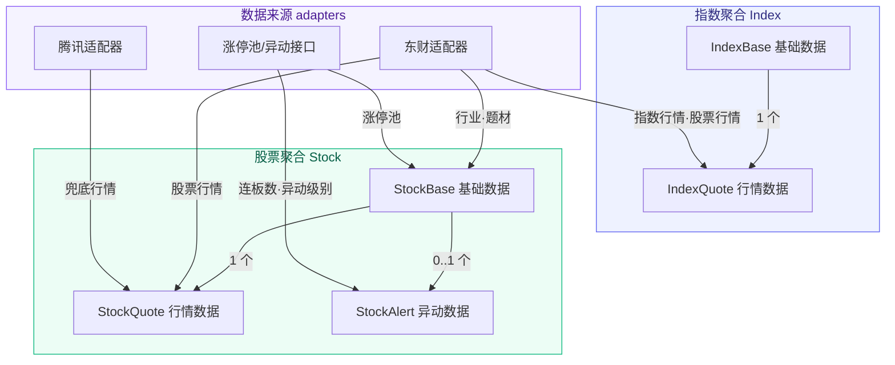
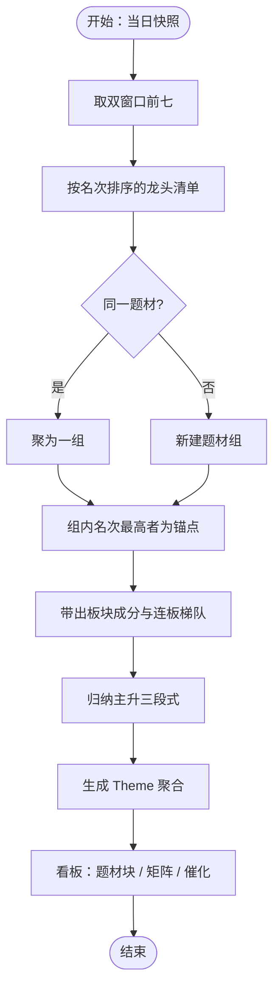
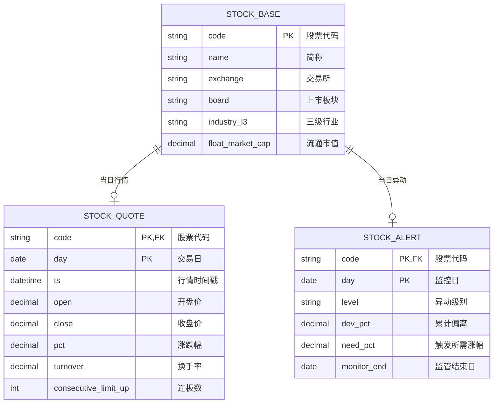
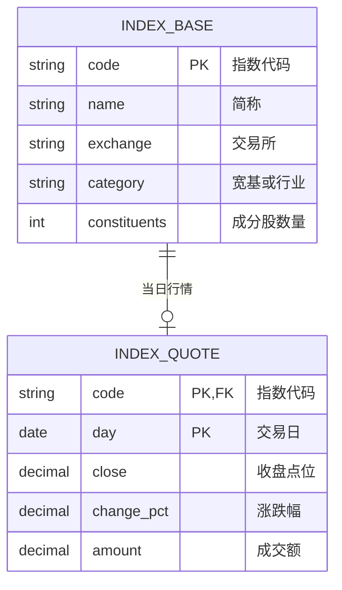
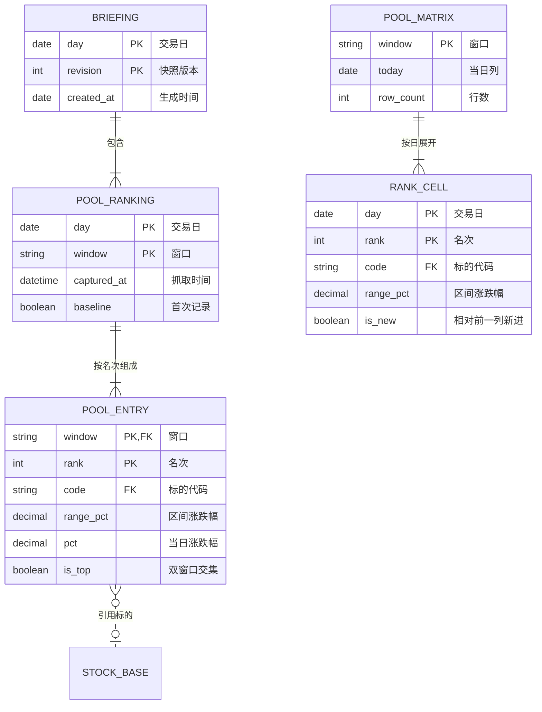
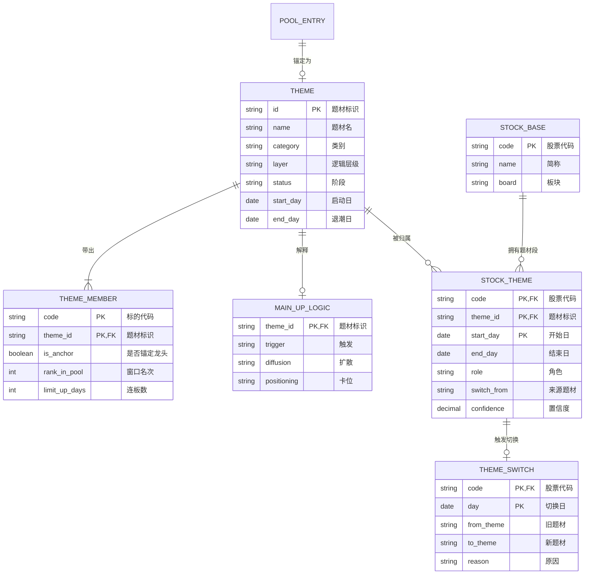
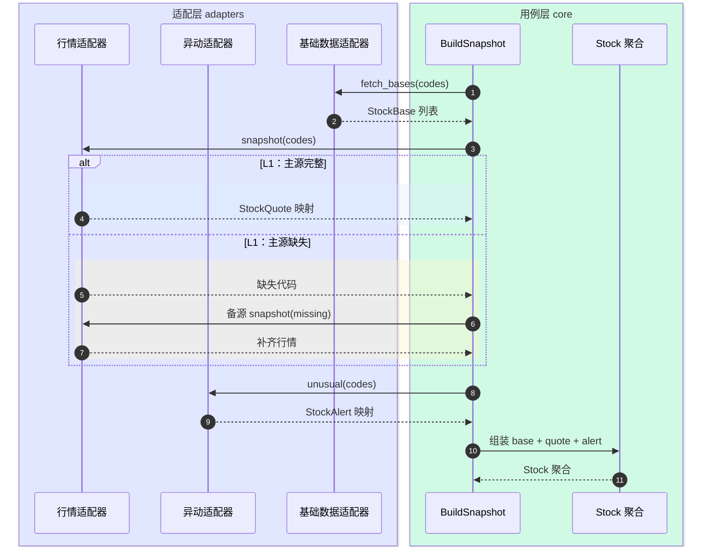
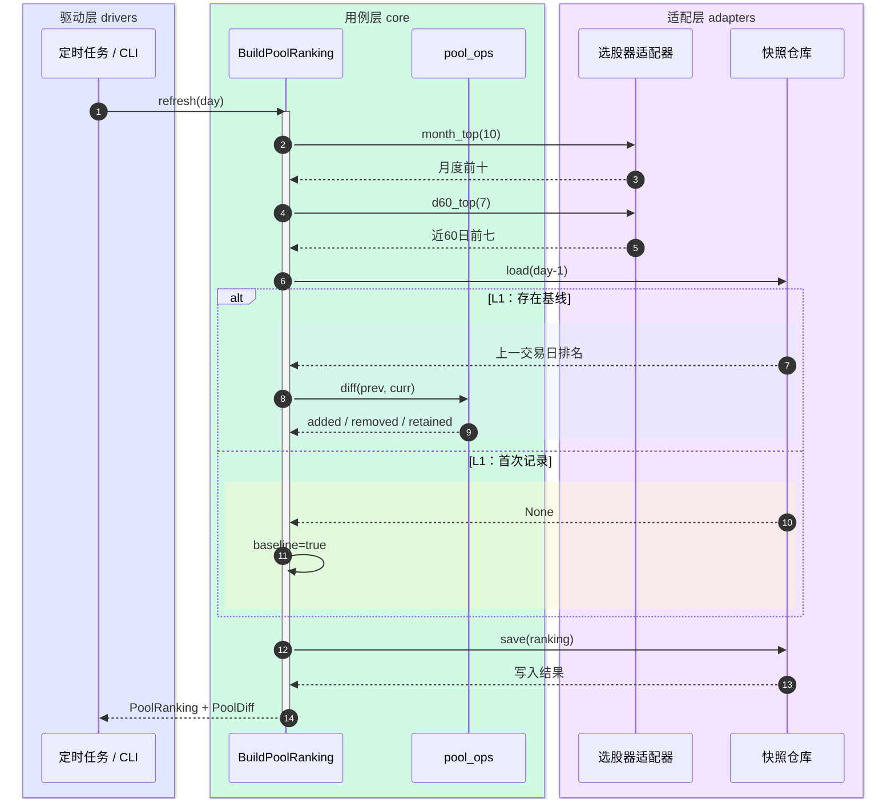

# 领域模型与实体关系

两个聚合根：`Index`（指数）与 `Stock`（股票）；股池是横切对象，题材由股池龙头**派生**而非独立维护。

> 题材不是标签库：先有「60 日前七 / 本月前七」的涨幅龙头，才有题材、板块效应与主升逻辑——以点带面。
>
> 本文是**整体领域设计**；各业务模块的细化领域设计见 `docs/business/*/领域设计.md`（索引：[30_业务蓝图](30_业务蓝图.md)）。

## 〇、代码位置

领域层在 `src/a_share_brief/domain/`：聚合 `aggregates/`、领域服务 `services/`、异常 `errors.py`：聚合按业务拆分：`common`（交易所/板块）、`market`（指数/日K）、`stock`（基础/行情/异动）、`pool`（股池）、`theme`（题材本体）、`theme_binding`（归属段与切换）、`briefing`（快照）；`__init__.py` 统一导出。

纯领域逻辑放 `domain/services/`：`pool`（差分/矩阵）、`theme_cluster`（以点带面）、`theme_switch`（切换校验）、`security`（板块映射）。服务不依赖端口与 IO，用例只做编排。

## 一、聚合结构

## 二、实体字段

### 2.1 指数

| 对象 | 关键字段 | 来源 |
| --- | --- | --- |
| `IndexBase` | code、name、exchange、category、constituents、launch_date | 东财 f58、代码前缀 |
| `IndexQuote` | day、ts、open/high/low/close、prev_close、change、change_pct、volume、amount | f46/f44/f45/f43、f60、f169/f170、f47/f48 |

### 2.2 股票

| 对象 | 关键字段 | 来源 |
| --- | --- | --- |
| `StockBase` | code、name、exchange、**board（决定 ±10/20/30）**、industry 三级、themes、list_date、is_st、float_market_cap | 选股器 `是否ST`、F10 `ssbk`/`hxtc`、f21 |
| `StockQuote` | day、ts、OHLC、prev_close、change/pct、volume/amount、**turnover**、volume_ratio、amplitude、**auction_pct**、**limit_state**、**consecutive_limit_up** | f168/f50/f171、选股器竞价列、涨停池 `lbc` |
| `StockAlert` | level、rule、dev_pct、threshold_pct、need_pct、current_pct、distance_pct、triggered_day、monitor_end | 预测接口 `x/t/a`、记录表 `TRADE_DATE` |
| `StockTheme` | code、theme_id、start_day、end_day、role、switch_from、confidence、evidence | 涨停池 + F10 + 资讯 |

### 2.3 动态股池

| 对象 | 关键字段 | 说明 |
| --- | --- | --- |
| `PoolWindow` | `MONTH` / `D60` | 月度前十（矩阵取前七）、近 60 日前七 |
| `PoolEntry` | code、rank、window、range_pct、pct、turnover、auction_pct、theme、is_top | 名次条目 |
| `PoolRanking` | day、window、entries、captured_at、baseline、note | 当日排名快照 |
| `PoolDiff` | prev_day、added、removed、retained | 与上一交易日差异 |
| `RankCell` | day、rank、code、range_pct、is_new | 矩阵单元格 |
| `PoolMatrix` | window、dates、rows、tail、today | 当月矩阵 |

### 2.4 题材

| 对象 | 关键字段 | 说明 |
| --- | --- | --- |
| `Theme` | id、name、**anchor_code/anchor_name、window、rank**、sector、members、logic、category、layer、narrative、status | 由龙头锚定的题材 |
| `ThemeMember` | code、name、role、**is_anchor**、rank_in_pool、range_pct、limit_up_days、via | 龙头带出的成员（板块效应） |
| `MainUpLogic` | **trigger → diffusion → positioning**、evidence | 主升三段式 |
| `StockTheme` | code、theme_id、start_day、end_day、role、switch_from、confidence | 个股归属段，支撑题材切换 |
| `ThemeSwitch` | code、day、from_theme、to_theme、reason、evidence | 切换事件 |

题材按炒作逻辑分层：**L1 名字/玄学 → L2 题材卡位 → L3 个股叙事 → L4 资金博弈 → L5 宏观**。L1 必须有涨停池同系标的佐证。

### 2.5 以点带面：题材如何从龙头长出来

设计理由：

1. **题材必须有锚点**：没有龙头的题材无法验证，也无法排序；`Theme.anchor_code/window/rank` 保证每个题材都能回指到榜单上的某一行。
2. **以点带面**：`ThemeMember` 承载板块效应（同题材跟风、连板梯队、区间涨幅），而非只存一个题材名字。
3. **主升逻辑可核对**：`MainUpLogic` 固定为「触发 → 扩散 → 卡位」，每段都要有涨停池/连板/资讯证据。
4. **题材会切换**：`StockTheme` 保留归属区间，`switch_from` 记录来源（如 洋/阳/洋 → 东方系）。
5. **不孤立维护**：题材由 `cluster_themes()` 从当日排名派生，天然跟随榜单变化，避免手工维护失真。

## 三、实体关系

### 3.1 股票域

### 3.2 指数域

### 3.3 股池与快照域

### 3.4 题材与切换

## 四、运行时序

### 4.1 聚合组装

### 4.2 股池刷新与差分

## 五、规则

- 聚合根不可变（`frozen=True`），更新以新实例替换。
- 行情与异动分离；异动不修改行情字段。
- 板块由代码前缀推导，涨跌停幅度据此判定。
- 金额统一为元、成交量按字段注释（股/手），展示层换算。
- 第三方字段名（f43、lbc）只允许出现在适配器映射层。
- **股池**：基线取上一不同交易日；只比前七；`total=0` 视为事实性空，标 `baseline` 且不写历史库；幂等键 `(day, window, rank)`。
- **题材**：同一标的同日只能一个生效题材，冲突抛 `ThemeConflict`；归属段区间不重叠，`switch_from` 必须等于上一段；切换保留旧段不删除，保证历史可复现。

### 5.1 题材切换触发条件

1. 旧题材涨停池同系标的连续 2 日下降且无新首板。
2. 新题材出现 ≥2 只涨停或龙头晋级。
3. 个股公告/资讯明确转向新叙事。

示例：东方海洋 `homophone`（洋/阳/洋）→ `east-family`（东方系），切换日 2026-11-10，`switch_from=homophone`，置信度 0.8。

## 六、索引（P2 落库）

| 实体 | 主键 | 索引依据 |
| --- | --- | --- |
| `STOCK_QUOTE` | (code, day) | 主键最左 `code` 覆盖单票查询 |
| `STOCK_ALERT` | (code, day) | 主键最左 `code` |
| `POOL_RANKING` | (day, window) | 主键最左 `day` |
| `POOL_ENTRY` | (window, rank, day) | 名次与当日查询 |
| `BRIEFING` | (day, revision) | 按日取最新版本 |
| `STOCK_THEME` | (code, theme_id, start_day) | 单票题材段查询 |

## 七、假设与待确认

- 当前为内存模型，表名与字段长度/精度为 P2 拟定。
- `POOL_ENTRY` 落库主键需补 `day`，跨日唯一。
- 指数分类 `category` 来源待确认（当前人工维护）。
- `Theme.keywords` 的扫描范围（全市场涨停池 + 资讯）待确认。

## 八、图校验

- 渲染器：`mmdc 10.9.1`（`npx @mermaid-js/mermaid-cli@10`，Chrome headless）。
- 流程图（聚合结构、股池生命周期、以点带面）：**静态校验和实际渲染通过：2 个图**（合计 3 张 flowchart）。
- 时序图（聚合组装、股池刷新）：**静态校验和实际渲染通过：2 个图**。
- ER 图（股票/指数/股池/题材四张）：**静态校验和实际渲染通过：4 个图**。
